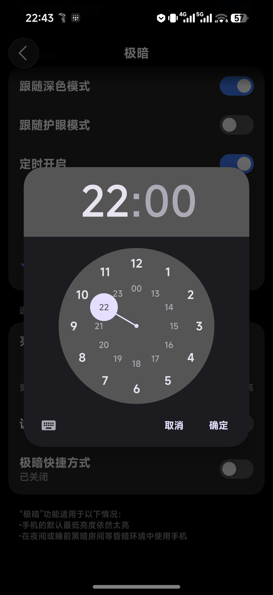

# FollowDark · 极暗跟随

[](https://github.com/MiFaZhan/followdark/releases)
[](https://developer.android.com)
[](https://github.com/JingMatrix/Vector)
[](LICENSE)

> 给 HyperOS 的「极暗」加上自动开启：跟随深色模式、跟随护眼模式、按时间段或日出日落联动。
> 开关直接出现在系统「设置 → 极暗」页面里，模块自身没有 App、没有桌面图标。

| 页面 | 时间段 |
| --- | --- |
|  |  |

## 功能

在「设置 → 极暗」页面注入一个 **自动开启** 分组，包含四个触发源：

| 触发源 | 行为 |
| --- | --- |
| 跟随深色模式 | 进入深色模式时打开极暗，退出时关闭 |
| 跟随护眼模式 | 系统护眼模式打开时联动极暗 |
| 定时 › 日出日落模式 | 日落时打开、日出时关闭（使用系统日落时间） |
| 定时 › 自定义时间 | 在设定的时间段内打开（默认 22:00–07:00） |

- **合成规则**：任意一个已启用的触发源成立即打开极暗；全部不成立才关闭。未启用任何触发源时，模块不会改写极暗状态。
- **事件驱动**：不轮询、不常驻端口、不使用后台服务，只在状态真正翻转时写入一次系统设置。
- **手动优先**：极暗本身的手动开关保持原样，任何时刻都可以直接关掉；下一次触发源变化时才会重新对齐。
- **桌面入口**：安装后桌面会出现一个「极暗」图标，点一下直接跳到极暗设置页（零界面，只做导航）。
- **干净卸载**：在框架中禁用模块并重启即恢复原生行为，只留下一个 `Settings.Secure` 配置键。

## 兼容性

| 项目 | 要求 |
| --- | --- |
| 系统 | HyperOS（已在 OS4.0.6.0.XBLCNXM / Xiaomi 17 Pro 验证）<br>AOSP 系的「极暗」页面如结构一致也可用 |
| Android | 11 – 17（API 30 – 37），`minSdk 29` |
| 框架 | LSPosed / Vector，Xposed API ≥ 93（经典 `assets/xposed_init` 模块） |
| 作用域 | `system`（system_server）、`com.android.settings` |

## 安装

1. 设备已 Root，并安装 LSPosed 或 Vector。
2. 安装 APK：

   ```bash
   adb install -r FollowDark-v2.7.apk
   ```

3. 在模块管理器中启用「极暗跟随」，确认作用域包含 **系统框架** 与 **设置**。
4. 重启设备。
5. 打开 **设置 → 极暗**，在「将屏幕调成极暗」下方可以看到「自动开启」分组。
   （也可以直接点桌面上的「极暗」图标，一步到这一页；系统设置里搜索「极暗」同样可达。）

> 从 LSPosed 模块仓库安装时可跳过第 2 步，其余步骤相同。

## 使用

- **定时**：打开「定时开启」后出现两个互斥选项，「日出日落模式」跟随系统日落时间，「自定义时间」使用下方的时间段。点「自定义时间」即可修改时间段（先选开始、再选结束）。
- **手动覆盖**：关闭所有触发源后，极暗完全由手动开关控制；触发源开着时，手动改动的值会保留到下一次触发源变化。
- **系统原生项不受影响**：亮度、设备重启后保持开启状态、极暗快捷方式等系统自带设置保持原状。

## 工作原理

模块由两部分组成，分别注入两个进程。

**Settings 进程**（`com.android.settings`）

通过 hook `DashboardFragment` 的 `onCreatePreferences` / `onStart` / `onResume`，在「极暗」页面的 `PreferenceScreen` 中插入一个 `PreferenceCategory`（标题「自动开启」），位置在原生开关之后、原生「选项」分组之前。分组内的单选行使用系统自带的 `miuix.preference.RadioButtonPreference`，与系统深色模式页保持一致的外观。

**system_server**（`android`）

hook `com.android.server.UiModeManagerService` 的夜间模式重算入口，读取最终生效的夜间状态（`mComputedNightMode`）。触发源来自：

| 触发源 | 数据来源 |
| --- | --- |
| 深色模式 | `UiModeManagerService.mComputedNightMode` |
| 护眼模式 | `Settings.System.screen_paper_mode_enabled` |
| 日出日落 | `TwilightManager.getLastTwilightState().isNight()` |
| 自定义时间段 | 模块自身的 `HH:mm` 配置，按本地时间计算 |

除上述 hook 外，还监听相关设置项的变化（`ContentObserver`），并在时间段边界、日落日出边界各安排一次性定时器；开机完成后再做两次延迟校准，以覆盖系统在开机时重置极暗状态的行为。所有设置写入都在独立线程完成，不占用 system_server 主线程。

## 配置

所有状态保存在 `Settings.Secure`，可以用 adb 直接读写：

| 键 | 取值 | 说明 |
| --- | --- | --- |
| `reduce_bright_colors_follow_dark` | `0` / `1` | 跟随深色模式 |
| `reduce_bright_colors_follow_eyecare` | `0` / `1` | 跟随护眼模式 |
| `reduce_bright_colors_follow_schedule` | `0` / `1` | 启用定时 |
| `reduce_bright_colors_schedule_mode` | `sun` / `custom` | 定时模式：日出日落 / 自定义时间 |
| `reduce_bright_colors_schedule_start` | `HH:mm` | 自定义时间开始 |
| `reduce_bright_colors_schedule_end` | `HH:mm` | 自定义时间结束 |

极暗本身的开关仍是系统键 `reduce_bright_colors_activated`。

## 从源码构建

无需 Android Studio 或 Gradle，只需要 JDK 17 与 Android SDK（`build-tools;37.0.0`、`platforms;android-36`）：

```bash
export ANDROID_HOME=$HOME/android-sdk
./build.sh          # 产物：build/followdark-v2.7.apk
```

构建流程为 `aapt2 → javac → d8 → zipalign → apksigner`。仓库内的 `keystore.jks`（自签名，密码均为 `android`）用于保持签名一致，使新版本可以直接覆盖安装。

项目结构：

```
AndroidManifest.xml          模块声明（xposedmodule / xposedminversion / xposedscope）
assets/xposed_init           入口类列表
res/values/arrays.xml        作用域声明
src/com/mifazhan/followdark/
  Main.java                  IXposedHookLoadPackage 入口
  JumpActivity.java          桌面入口：零界面跳到极暗设置页
  Core.java                  设置读写、时间窗口、反射工具、偏好项工厂
  SettingsHooks.java         极暗页面注入
  SystemHooks.java           system_server 侧触发源合成
build.sh                     命令行构建脚本
```

## 问题反馈

提交 issue 时请附上系统版本、框架版本，以及模块日志：

```bash
adb logcat -s FollowDark
```

## 许可证

[MIT](LICENSE)

## 致谢

- [Vector](https://github.com/JingMatrix/Vector) 与 [LSPosed](https://github.com/LSPosed/LSPosed)：现代 Xposed 框架
- AndroidX Preference 与 miuix：设置页组件
