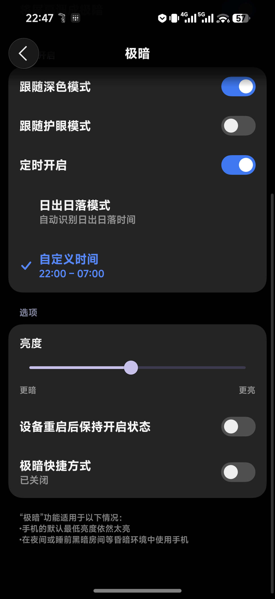

# 极暗跟随（FollowDark）

给 HyperOS 的「极暗」加上自动开启，开关直接长在 **设置 → 极暗** 页面里。



| 触发源 | 说明 |
| --- | --- |
| 跟随深色模式 | 深色模式开 → 极暗开，关 → 极暗关 |
| 跟随护眼模式 | 系统护眼模式开 → 极暗开 |
| 定时 › 日出日落模式 | 按系统日落/日出自动开关 |
| 定时 › 自定义时间 | 按你设的时间段（默认 22:00–07:00）自动开关 |

任意一个已启用的源成立就打开极暗，全部不成立才关闭；一个都没启用时模块不碰极暗。

- Xposed 模块（老 API 82 接口），Vector / LSPosed 通用；**没有桌面图标、没有 App**
- 作用域：`system`（system_server）+ `com.android.settings`
- 事件驱动，无轮询；只在状态翻转时写一次 `settings secure`
- 卸载/禁用即恢复原生行为

## 安装

```bash
adb install -r FollowDark.apk
# Vector / LSPosed 里启用模块（scope 已通过 xposedscope 声明：system + com.android.settings）
adb reboot
```

也可以在 LSPosed 模块仓库里找「极暗跟随」（提交中，见 `xposed/` 与 `scripts/publish-module-repo.sh`）。

## 构建

不需要 Android Studio / Gradle：

```bash
export ANDROID_HOME=$HOME/android-sdk   # 需要 build-tools;37.0.0 + platforms;android-36
./build.sh                              # 产物：build/followdark-v<ver>.apk
```

`build.sh` 会用到仓库里的 `keystore.jks`（自签名，密码均 `android`），保证每次构建签名一致、能覆盖升级。

---

## 功能细节

在「极暗」设置页注入一个「自动开启」分组（排在原生开关下面、原生「选项」分组上面）：

| 开关 / 选项 | 触发条件 | 数据来源 |
| --- | --- | --- |
| 跟随深色模式 | 系统进入夜间 | `UiModeManagerService.mComputedNightMode` |
| 跟随护眼模式 | 护眼模式开着 | `Settings.System.screen_paper_mode_enabled`（HyperOS 内部叫 paper mode） |
| 定时开启 › 日出日落模式 | 系统判定已日落、未日出 | `TwilightManager.getLastTwilightState().isNight()` |
| 定时开启 › 自定义时间 | 当前时间落在时间段内 | 模块自己的 `HH:mm`，默认 22:00–07:00 |

「定时」按小米深色模式页的模型做：**一个总开关 + 两个互斥模式**（日出日落模式 / 自定义时间），
选「自定义时间」才出现「时间段」那一行 —— 这一点是照着系统深色模式页的结构抄的：

```
深色模式设置（系统原生）
  自动切换深色模式        [开关]
  日出日落模式            智能识别日出日落时间，自动开启和关闭深色模式
  自定义时间              根据您设置的时间段，自动开启和关闭深色模式
  应用单独设置
```

合成规则：**任意一个已启用的源成立 → 极暗开；全都成立不了 → 极暗关。** 一个都没启用时，模块完全不碰极暗。

- 模块包名：`com.mifazhan.followdark`，版本 2.2（versionCode 10）
- 作用域：`system`（system_server）+ `com.android.settings`
- **没有桌面图标**：没有 Activity，装完只出现在 Vector/LSPosed 的模块列表里

## 怎么用

设置 → 无障碍 → 极暗（或搜索「极暗」），页面里从上到下：

```
将屏幕调成极暗                       [开关]   ← 系统原生

自动开启 ←（模块注入的 PreferenceCategory：组标题 + 一张卡片）
  跟随深色模式                       [开关]
  跟随护眼模式                       [开关]
  定时开启                           [开关]
  时间段  22:00 – 07:00                 ›      ← 只在「定时开启」开着时出现，点开改时间
  日出日落                           [开关]

选项 ←（系统原生分组，一个没动）
  亮度 / 设备重启后保持开启状态 / 极暗快捷方式
```

> 叫法：这种「组标题 + 一张卡片包住若干行」的东西在 Android 里叫**分组**（`PreferenceCategory`），
> 「自动开启」和原生的「选项」就是这个标题文字。原生「将屏幕调成极暗」是页面顶层的独立条目，不属于任何分组。

开关不配解释文字（保持和系统设置一样的密度）；「自定义时间」那一行的副标题就是时间段，
点它 = 选中该模式 + 弹系统的时钟选择框（先开始、后结束，跟着深/浅色主题走）。

「定时开启」关掉时，下面两行单选**立刻整块隐藏**（和系统深色模式页一致：实测把「自动切换深色模式」
关掉后，日出日落模式/自定义时间直接消失、下面的「应用单独设置」上移）。开关的点击回调里会主动
`refreshState()`，所以不用退出页面再进来。

## 实现要点

### Settings 侧

页面的 preference 树（OS4.0.6.0 / Android 17 实测）：

```
PreferenceScreen
  0 top_intro                    TopIntroPreference
  1 animated_image               IllustrationPreference
  2 reduce_bright_colors_switch  MainSwitchPreference      ← 原生「将屏幕调成极暗」，order=2
  3 general_categories           PreferenceCategory（选项）  order=3
  4 html_description             order=2147483646
```

- hook `DashboardFragment` 的 `onCreatePreferences` / `onStart` / `onResume`，用页面类名判断是不是极暗页。
- 注入一个 `PreferenceCategory`（标题「自动开启」），里面放 4 个开关 + 时间段行，位置排在原生开关正下方、原生「选项」分组之前。这里有三个坑：
  0. 「日出日落模式 / 自定义时间」用 miuix 的 `RadioButtonPreference`（小米深色模式页同款行样式，左边一个 ✓），但**不能**再套一层 `RadioButtonPreferenceCategory` —— 嵌套之后外层分组卡片会渲染不出来（实测变全黑）。勾选态由模块自己维护（`setChecked`）。
  1. androidx 的 `addPreference` 只按 `order` 排序，而这一页每项都显式写了 `order`，直接 add 会被排到最后 —— 所以先把 anchor 之后各项的 `order` 整体后移，再给我们的项排在 `2+1..2+5`，最后才 add。
  2. Settings 里的 androidx 被 R8 混淆过，`PreferenceGroup` 的私有 list 字段名不可靠，需要按「类型是 List 且里面装着 anchor」来找，不能按名字。
  3. 新建的 `PreferenceCategory` 必须先 `addPreference` 到页面上（这时才拿到 `PreferenceManager`），再往里加子项；否则子项 `addPreference` 会 NPE（`getNextId()` on null）。
- 原生开关的 key 是 `reduce_bright_colors_switch`（不是老的 `reduce_bright_colors_preference`，代码里两个都试，找不到会把整棵树打进日志）。

### system_server 侧

hook `com.android.server.UiModeManagerService`：`updateConfigurationLocked` / `updateComputedNightModeLocked` / `updateNightModeFromSettingsLocked` / `applyConfigurationExternallyLocked` / `onBootPhase`。

事件来源（**没有轮询**）：

1. 上面这些夜间模式重算点（深色、日落都从这里过）
2. `ContentObserver` 监听 6 个开关/时间 key + 护眼模式 `Settings.System`
3. 定时窗口边界、日落/日出边界各用一次性 `postDelayed`，只在边界醒一次
4. 开机 `PHASE_BOOT_COMPLETED` 一次 + `+20s`/`+60s` 两次复查（系统开机会把极暗复位成 0，必须纠正）

所有写 settings 的动作都在独立 `HandlerThread` 上，不占 system_server 主线程。

## 存储（可直接用 adb 调）

```bash
# 四个触发源（1=开，0=关）
settings put secure reduce_bright_colors_follow_dark     1
settings put secure reduce_bright_colors_follow_eyecare  1
settings put secure reduce_bright_colors_follow_schedule 1
settings put secure reduce_bright_colors_follow_sunrise  1

# 定时：模式 + 时间段（mode = sun 日出日落 / custom 自定义时间）
settings put secure reduce_bright_colors_schedule_mode  custom
settings put secure reduce_bright_colors_schedule_start 22:00
settings put secure reduce_bright_colors_schedule_end   07:00

# 结果（系统自己的键，ColorDisplayService 监听它）
settings get secure reduce_bright_colors_activated
```

## 构建

不需要 Gradle / Android Studio：

```bash
export ANDROID_HOME=$HOME/android-sdk   # 需要 build-tools;37.0.0 + platforms;android-36
./build.sh
```

`aapt2 compile/link` → `javac -source 8 -target 8 -bootclasspath android.jar` → `d8` → 塞 `classes.dex` → `zipalign` → `apksigner`（首次自动 keytool 生成 `keystore.jks`，密码 `android`）。

Xposed 编译桩：`libs/api-82.jar`（来自 `api.xposed.info`）。

```
AndroidManifest.xml          # xposedmodule / xposedminversion=93 / xposedscope，无 activity
assets/xposed_init           # → com.mifazhan.followdark.Main
res/values/arrays.xml        # xposed_scope = system, android, com.android.settings
src/com/mifazhan/followdark/
  Main.java        # IXposedHookLoadPackage 入口，按包名分发
  Core.java        # 开关读写、时间窗口、反射工具、偏好项工厂
  SettingsHooks.java  # 极暗页面注入
  SystemHooks.java    # system_server 合成逻辑（四源 OR）
build.sh
```

## 安装

```bash
adb install --no-incremental -r build/followdark-v2.2.apk

# 也可以用 Vector 自带的命令行启用，不必点 UI
adb shell /data/adb/lspd/cli modules enable com.mifazhan.followdark
adb shell /data/adb/lspd/cli scope set com.mifazhan.followdark system/0 com.android.settings/0

adb reboot     # 生效
```

踩过的坑，记一下：

1. **system_server 的作用域名是 `system`，不是 `android`**（`/data/adb/lspd` 的 scope 表里就是这么写的）。
2. 卸载重装会**连带删掉 LSPosed 里这个模块的配置行和 scope**（外键级联），要重新 enable + scope。
3. `adb install --incremental` 装完再重启，出现过一次 daemon 认不到包（`Failed to find path of ...`），改用 `--no-incremental` 就好。

## 验证状态（2026-11-20 22:00–22:30，Xiaomi 17 Pro / OS4.0.6.0.XBLCNXM / Android 17）

| 项 | 操作 | 结果 |
| --- | --- | --- |
| 分组形态 | 打开极暗页 | 「自动开启」分组（4 开关 + 时间段行）夹在「将屏幕调成极暗」和原生「选项」分组之间 |
| 组内开关可点 | 点「跟随护眼模式」开关 | 设置值 0 → 1 → 0，页面状态同步 |
| 跟随深色 | `cmd uimode night no` / `yes` | activated 1 → 0 → 1 |
| 跟随护眼 | `settings put system screen_paper_mode_enabled 0/1/0` | activated 0 → 1 → 0 |
| 定时 › 自定义时间 | 窗口 22:00–07:00（含当前）→ 23:50–23:55（不含） | activated 1 → 0 |
| 定时 › 日出日落模式 | `schedule_mode=sun` | 日志 `scheduleMode=sun(true) => want=true`，activated=1 |
| 单选项渲染 | 打开「定时开启」 | 两行单选出现，「✓ 自定义时间」蓝色高亮 |
| 选日出日落 | 点「日出日落模式」 | mode=sun，勾移到该行，activated 仍跟 TwilightState |
| 点自定义时间 | 点该行 | mode=custom + 弹出时间段时钟框 |
| 时间段弹窗 | 点「时间段」 | 弹出深色主题的时钟选择框（先开始后结束） |
| 无 App | `cmd package resolve-activity --brief com.mifazhan.followdark` | `No activity found`（桌面无图标） |
| 开机自愈 | 跟随深色开 + 深色开 → 重启 | 开机 20s 复查后 activated=1 |
| 干净停用 | — | 未实测（Vector 里禁用 + 重启即可；模块不注册任何服务/接收器） |

### 版本兼容边界

| 项 | 实际情况 | 与 AOSP 的差异 |
| --- | --- | --- |
| 设置页 Activity | `com.android.settings.Settings$ReduceBrightColorsSettingsActivity` | 一致 |
| 页面 Fragment | `com.android.settings.accessibility.ToggleReduceBrightColorsPreferenceFragment` | ⚠️ 在 `accessibility` 包（老版本在 `display`） |
| 原生开关 key | `reduce_bright_colors_switch` | ⚠️ 不是 AOSP 文档里常见的 `reduce_bright_colors_preference` |
| Fragment 继承链 | DashboardFragment → SettingsPreferenceFragment → … → settingslib PreferenceFragment → **miuix.preference.PreferenceFragment** → androidx PreferenceFragmentCompat | ⚠️ HyperOS 多一层 miuix 包装，最底下还是 androidx |
| `UiModeManagerService.updateConfigurationLocked` | 无参 `()V` | ⚠️ 老版本是 `(int, boolean)`；按方法名 hook，签名变了也不崩 |
| 护眼模式 | `Settings.System.screen_paper_mode_enabled` | MIUI/HyperOS 特有，AOSP 没有 |
| `PreferenceGroup` 私有字段 | 被 R8 混淆 | 只能按类型找 List 字段，不能按名字 |

## 已知取舍

- 手动把极暗关掉后不会被立刻改回来，要等下一次触发源变化（深色切换/护眼切换/时段边界）才重新对齐。反过来，只要某个源一直成立，手动关掉也会在下次事件时被打开。
- 「跟随护眼模式」读的是护眼模式的开关状态；HyperOS 护眼自己也有定时/日出日落，那些由系统去开关护眼，模块只跟随它的结果。
- 「日出日落模式」直接复用系统的日落判定（和深色模式自动切换用的是同一份 TwilightState），不自己算经纬度。
- 定时想要「时间段」和「日出日落」同时生效是没意义的，所以做成二选一，和系统一致。
- 时间段没有单独的层级，它挂在「自定义时间」的副标题上（等于这一项的下级），点该项同时改时间。
